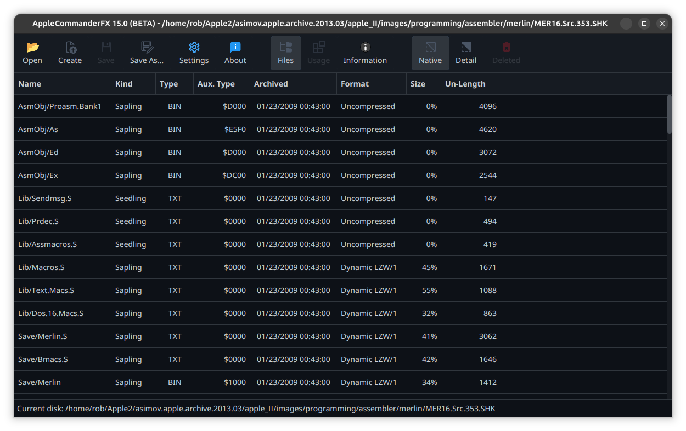

# AppleCommanderFX Screenshots

AppleCommanderFX is intended to be the replacement for the existing AppleCommander GUI application.
It is currently in BETA, and mostly supports disk or archive browsing at this point.

Here are a few screenshots from AppleCommanderFX.

Launch window:

File listing:

Disk usage:

Disk usage (larger HDD's):

Create image wizard:

